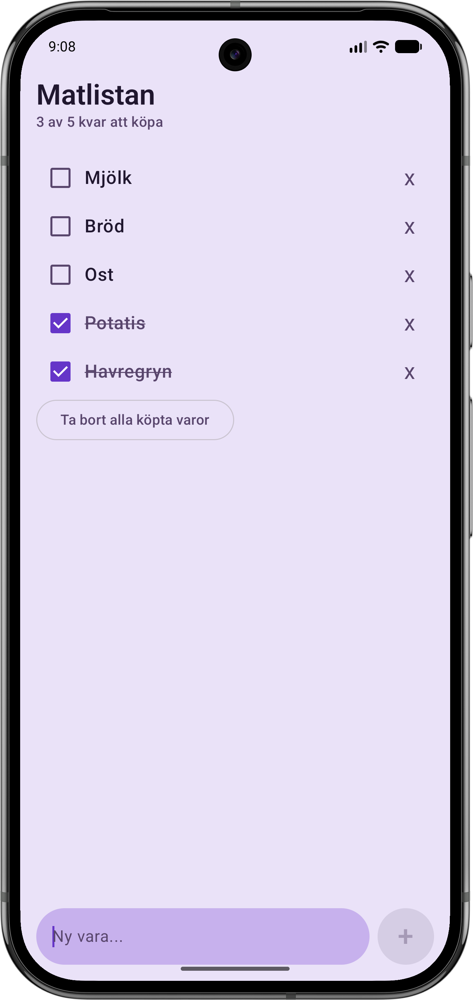

# Matlistan

Matlistan är en enkel Android-app för att skapa en inköpslista. Appen är byggd med Kotlin och Jetpack Compose.

### Funktioner
- Lägga till varor i listan
- Markera varor som köpta
- Ta bort enskilda varor
- Ta bort alla köpta varor
- Se hur många varor som finns kvar att köpa

### Teknik
- Kotlin
- Jetpack Compose
- Material 3

Appen är ett övningsprojekt och sparar ännu inte listan när appen stängs.

### Skärmbild

